# Setpoint

Setpoint turns a regular, non-smart thermostat into a smart one. SwitchBot Bots press the up and down buttons, and optionally the Mode button, and you control it from a phone app.

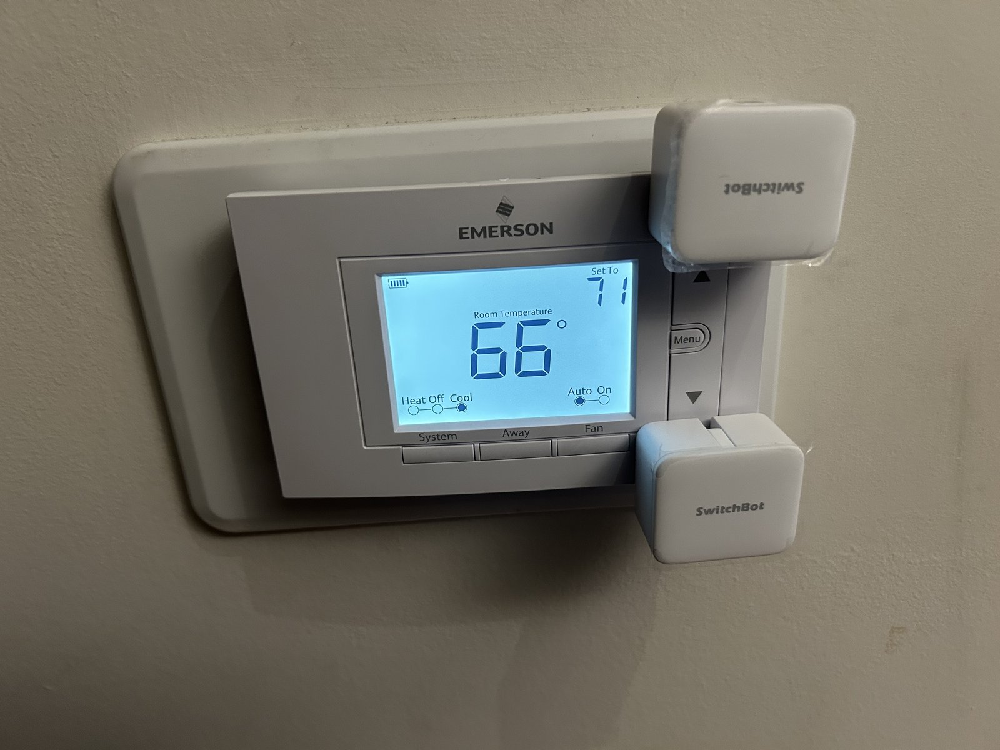

## Why I made this

I wanted to turn my regular thermostat into a smart one. I wanted to be able to adjust it from my phone and add the ability for custom complex requests even most smart thermostats can't handle.

## What it does

- Set the temperature from your phone with the dial or a preset (Sleep, Wake, Away, Home). Rapid plus and minus taps combine into one command.
- Switch Heat, Off, or Cool with a third SwitchBot Bot on the thermostat's Mode button. Heat and Cool keep their own setpoints. Off has no setpoint, and plus or minus change only the active mode's number.
- If you change the temperature while a mode change is still running, the mode change finishes first. The temperature change then runs against the new mode's setpoint, and the app shows the queued step. Switching to Off refuses a temperature change and keeps going.
- Run a daily schedule (by default, Sleep at 66°F at 10:00 PM and Wake at 70°F at 7:00 AM). You can edit it, turn an event off without deleting it, skip a run, or run an event now.
- Hold a temperature you set by hand until you resume the schedule. The schedule waits while the thermostat is Off or the mode is unknown.
- Recalibrate the mode and the active Heat or Cool setpoint when the thermostat display and the app disagree. Saving records what the display shows and does not press any buttons. Setpoint will not press the Mode bot until the mode is named.
- Show bot battery levels in Settings. A reading at or below 20% warns on Home and in Settings.
- Chart room temperature, humidity, and CO2 over a day, week, month, or year, with your setpoint changes marked.
- Let an AI assistant or Siri control it through an MCP server with 13 tools, including `set_mode` and `recalibrate_mode`.

## How it works

The thermostat cannot report the number on its display, so Setpoint tracks a virtual setpoint by counting successful button presses. Heat and Cool each keep their own number. The number you see is the active mode's setpoint. Off and an unknown mode have none.

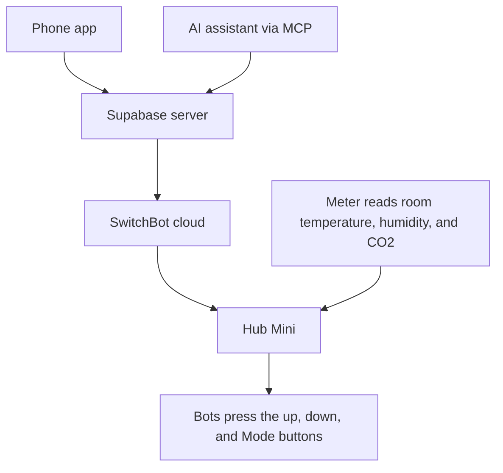

You enter the display number once, and you name the mode the display is in. Each successful up press then adds one step (default 1°F) and each successful down press subtracts one, on the active Heat or Cool setpoint only. If someone presses the physical buttons, or the count drifts, use Recalibrate. Setpoint never waits for the room to reach a target, and it never copies the room sensor into the setpoint. The meter is read-only.

The Emerson Mode button cycles Heat, Off, Cool. One press of the Mode bot moves a configured number of steps in that cycle. The default is two modes forward, because this bot often over-presses. You can set it to one mode forward in Settings if a later bot presses cleanly.

To change the temperature, the app presses the correct bot the right number of times, waiting between presses (default 1 second) so the thermostat can register each one. Requests outside the allowed range (default 50 to 85°F) or over the press cap (default 15) are refused before any press. If a press fails, Setpoint stops, keeps the presses that already succeeded, and does not count the failed one. An optional setting, off by default, uses the first press only to wake the display and does not change the tracked setpoint. A temperature change started during a mode change is queued until the mode change finishes, then it uses the new mode's setpoint.

There are two live paths. On an iPhone, the app can call the SwitchBot Open API directly, with the token in the Keychain. When `EXPO_PUBLIC_SUPABASE_URL` and `EXPO_PUBLIC_SUPABASE_PUBLISHABLE_KEY` are set and the app is in live mode, the shared server owns those calls, stores history, and keeps the scheduler running while the phone is asleep. Live control from the browser is not supported. Demo mode never contacts SwitchBot or the server, and there is no Bluetooth fallback.

Schedules use America/New_York (Eastern Time). Catch-up applies only the latest due target and marks earlier ones missed. A disabled event stays in the list and never runs. Re-enabling it resets the catch-up cursor so missed occurrences are not replayed.

## Screenshots

These are from the in-browser demo, at iPhone size. The room readings and charts are simulated. Sleep and Wake are the default schedule.

<table>
  <tr>
    <td align="center">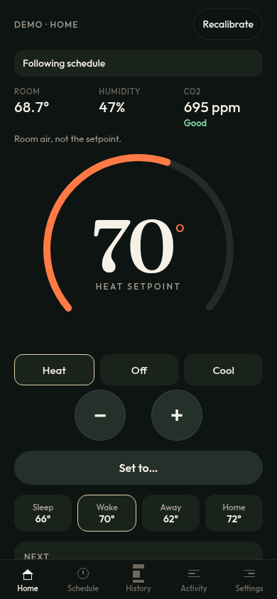<br>Home</td>
    <td align="center">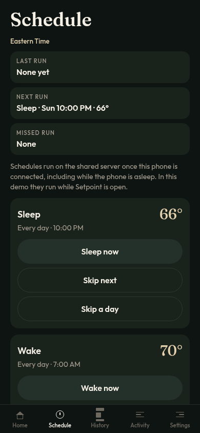<br>Schedule</td>
    <td align="center">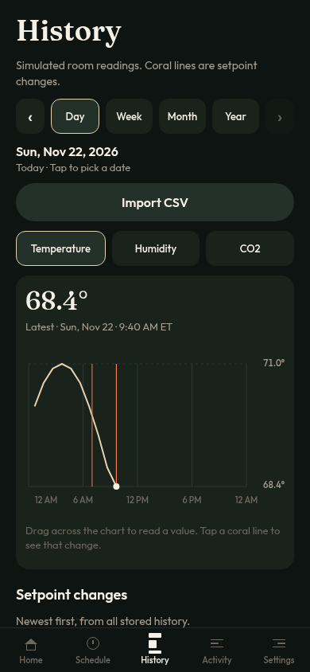<br>History, day</td>
  </tr>
  <tr>
    <td align="center">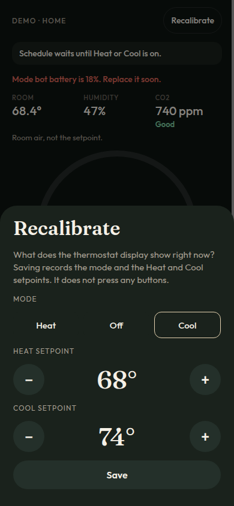<br>Recalibrate</td>
    <td align="center">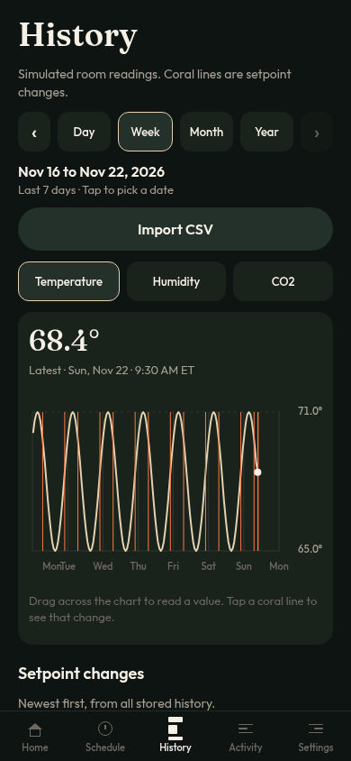<br>History, week</td>
    <td align="center">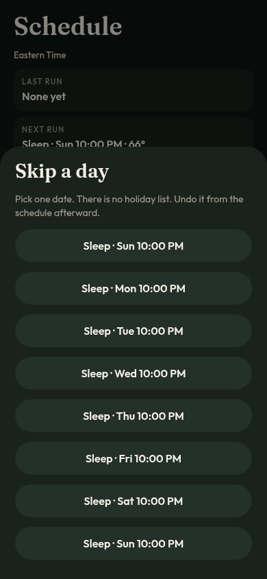<br>Skip a day</td>
  </tr>
  <tr>
    <td align="center">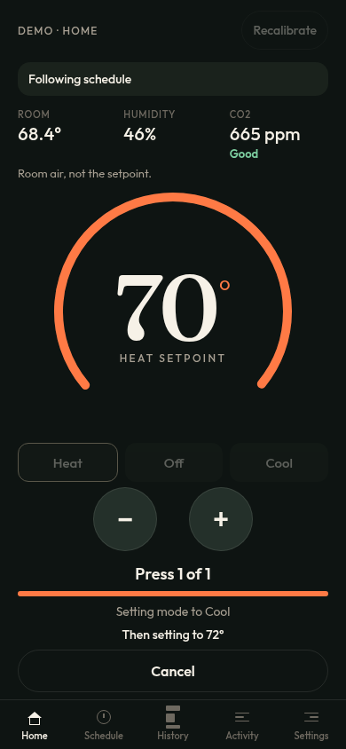<br>Mode change, then temp</td>
    <td align="center">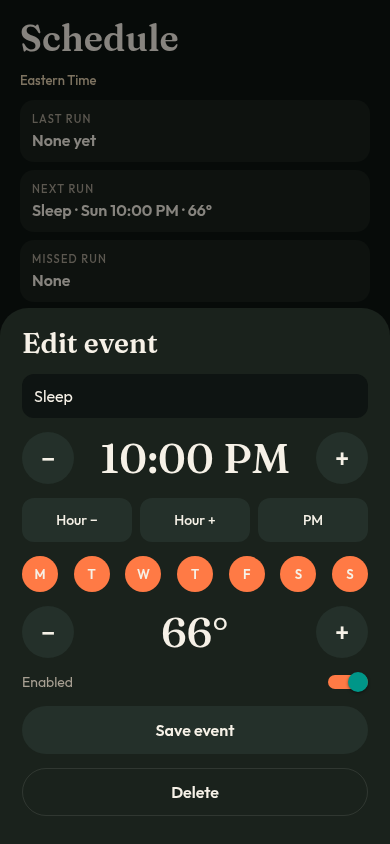<br>Edit a schedule event</td>
    <td align="center">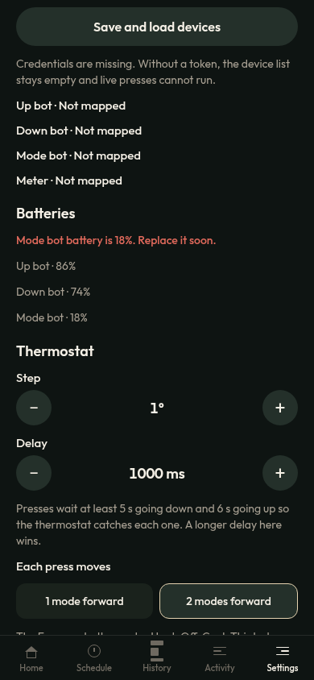<br>Batteries and mode step</td>
  </tr>
</table>

## What you need

Hardware, for live control:

- A regular thermostat with physical up and down buttons. This project was built around an Emerson.
- Two SwitchBot Bots, set to Press Mode, mounted on those buttons.
- Optional, for Heat, Off, and Cool control: a third SwitchBot Bot, also in Press Mode, mounted on the Mode button.
- A SwitchBot Hub Mini, or another SwitchBot hub, near the devices, with cloud service enabled.
- A SwitchBot Meter Pro (CO2), or another SwitchBot meter that reports temperature, humidity, and CO2.

Accounts and software:

- A SwitchBot account, plus an Open API token and secret. In the SwitchBot app: Profile, Preferences, About, tap the app version about 10 times, then Developer Options, token and secret.
- For the shared server, history on the server, schedules while the phone is asleep, and assistant control: a free Supabase project and the [Supabase CLI](https://supabase.com/docs/guides/cli).
- Node.js 22.13 or later. This app uses Expo SDK 58, which supports Node 22.13+, 24.3+, or 26+. Odd-numbered releases such as 23 and 25 are not supported.
- Expo Go, if you want to run the app on a phone during development.

You can try the app in demo mode with only Node.js. No SwitchBot account or Supabase project is required for that.

## Getting started

### Try the demo

Demo mode is the default. It uses simulated devices and works without any environment variables.

```bash
git clone https://github.com/sixtusijoma/setpoint.git
cd setpoint
npm install
npm run web
```

`npm run web` serves the app on port 43117. Open [http://127.0.0.1:43117](http://127.0.0.1:43117), tap Try the demo, and enter a starting temperature. You can turn the dial, switch Heat, Off, or Cool, run Sleep now, edit the schedule, and browse the charts. The simulated room starts near 68.4°F, 47% humidity, and about 740 ppm CO2. Pull to refresh drifts that room. It does not move the setpoint.

On a phone with Expo Go:

```bash
npm start
```

Then scan the QR code. `npm start` runs `expo start`. `npm run ios` and `npm run android` start the same dev server pointed at those platforms.

### Set up live control

1. Mount the two bots on the thermostat's up and down buttons, in Press Mode. If you have a Mode bot, mount it on the Mode button the same way. Place the Hub Mini nearby with cloud service enabled, and place the meter in the room.
2. Copy the SwitchBot Open API token and secret from the SwitchBot app, using the path under [What you need](#what-you-need).

**Phone only.** You can skip the server and run live mode from the iPhone app. Start the app, choose Connect SwitchBot, enter the token and secret, map the up bot, down bot, and meter, then enter the number on the thermostat display and name the mode it is in. The Mode bot is optional and can be mapped later in Settings. The token stays in the Keychain via `expo-secure-store`. This is not a safe path in the browser: a token saved there lasts only for that tab session, and cloud control from the browser is blocked. Without the shared server, the scheduler only runs while the app can run.

**Shared server.** Use this when you want schedules to keep running while the phone is asleep, history stored on the server, and assistant control through MCP. The steps below are the main path. [DEPLOY.md](DEPLOY.md) has the full detail, including cron jobs and how each function is authenticated.

1. Create a free Supabase project, then from this repo, with the Supabase CLI logged in as an owner of that project:

   ```bash
   supabase link --project-ref <your-project-ref>
   supabase db push
   ```

   That applies `supabase/migrations/20261111120000_setpoint.sql`, `supabase/migrations/20261112120000_meter_import.sql`, `supabase/migrations/20261112180000_setpoint_change_pages.sql`, `supabase/migrations/20261113090000_history_windows.sql`, and `supabase/migrations/20261118120000_system_mode.sql`. On a project that already runs, `supabase db push` and then `supabase functions deploy history` and `supabase functions deploy mcp` is all that browsing older History windows needs. The system-mode migration is additive: it copies the old setpoint onto both Heat and Cool, leaves the thermostat mode unknown, and adds the mode-bot slot plus a battery cache. Apply it before redeploying `state`, `press`, `recalibrate`, `tick`, `meter`, `mcp`, `set-mode`, and `recalibrate-mode`. See [DEPLOY.md](DEPLOY.md).

2. Set these function secret names in the project. The CLI prompts for the values. Do not put the values in the repo, in `EXPO_PUBLIC_*` variables, or in the app bundle.

   ```bash
   supabase secrets set SWITCHBOT_TOKEN SWITCHBOT_SECRET SETPOINT_APP_KEY SETPOINT_MCP_KEY CRON_SECRET
   ```

   Generate `SETPOINT_APP_KEY` yourself and enter the same value once in the app later. `SWITCHBOT_TOKEN` and `SWITCHBOT_SECRET` can be omitted here if the phone will upload them through Settings. The scheduler still needs one of those two sources before it can press.

3. Deploy the functions:

   ```bash
   supabase functions deploy state
   supabase functions deploy press
   supabase functions deploy recalibrate
   supabase functions deploy session
   supabase functions deploy tick
   supabase functions deploy meter
   supabase functions deploy history
   supabase functions deploy import-meter
   supabase functions deploy credentials
   supabase functions deploy devices
   supabase functions deploy prune
   supabase functions deploy mcp
   supabase functions deploy set-mode
   supabase functions deploy recalibrate-mode
   ```

4. Schedule the server jobs as described in [DEPLOY.md](DEPLOY.md). A tick runs every minute, a meter read every 10 minutes, and a prune job once a day.

5. Point the app at the project. You can export these in your shell, or put them in a `.env` file in the project root (that file is gitignored):

   ```bash
   EXPO_PUBLIC_SUPABASE_URL=https://<project-ref>.supabase.co
   EXPO_PUBLIC_SUPABASE_PUBLISHABLE_KEY=<the public anon key>
   ```

   Use the public anon key, not the service role key. The service role key stays on the server. Do not put the SwitchBot token, the MCP key, or the app key in these variables. Demo mode ignores them.

6. Start the app with `npm start` or `npm run ios`. When those two variables are set, the app asks for `SETPOINT_APP_KEY` once and stores it with `expo-secure-store` on iOS and Android. On the web demo, secure storage is unavailable, so the key stays in `sessionStorage` for that tab only. Then enter the SwitchBot token and secret if the server does not already have them, map the devices, enter the number on the thermostat display, and name the mode it is in.

## Control it with Siri

I use an iOS Shortcut named Thermostat. It runs Dictate Text, then sends that text with the Grok Bot app's Send Message action to my Thermostat bot. The bot controls Setpoint through its MCP server, so a phrase like "Going to bed early tonight set sleep now" can run Sleep now, the same command the app uses. I trigger the shortcut with Siri, or with Back Tap.

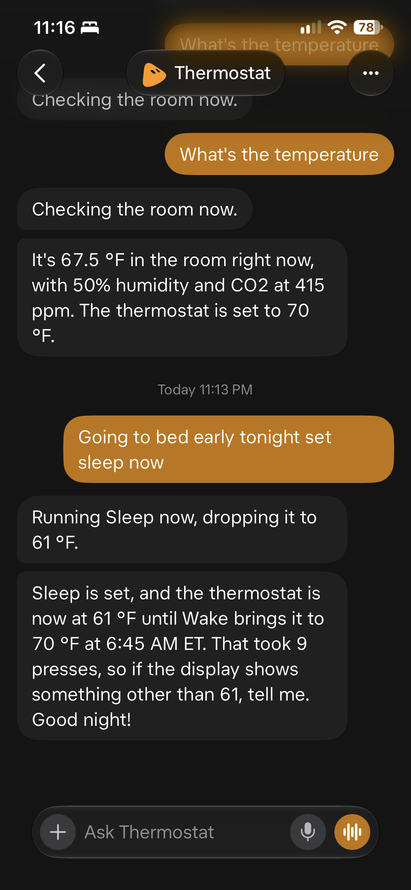

## Control it with an AI assistant

After the shared server is deployed, an MCP client can call:

```text
https://<project-ref>.supabase.co/functions/v1/mcp
```

with this header:

```text
Authorization: Bearer <SETPOINT_MCP_KEY>
```

Send JSON-RPC over HTTP `POST` with `Content-Type: application/json`. The function also accepts `Accept: application/json`. If the gateway asks for an `apikey` header, send the public anon key there. The function does not treat that header as the MCP secret. The app key does not open this endpoint.

A client starts with `initialize`, then `notifications/initialized`, then `tools/list` and `tools/call`.

There are 13 tools: `set_to`, `nudge`, `read_room`, `room_history` (`span` of `day`, `week`, `month`, or `year`, or both `since` and `until` as ISO timestamps, 800 days at most; ranges over 120 days come back as daily Eastern Time averages), `import_meter_csv` (`csv` is the CSV text; the result is the same summary as `import-meter`), `show_schedule` (each event is marked enabled or disabled), `edit_schedule` (pass `enabled` true or false to turn an event on or off without changing anything else; days can never be empty; re-enabling resets the catch-up cursor so missed occurrences are not replayed), `skip_wake` (pass `undoKey` to undo), `run_schedule_now` (refuses a disabled event), `set_mode` (presses the Mode bot until the thermostat is heat, off, or cool; refuses while the tracked mode is unknown), `recalibrate_mode` (sets the tracked mode and presses nothing), `recalibrate` (corrects the active Heat or Cool setpoint to what the display shows, presses nothing, and refuses while Off or unknown), and `status` (`mode` is demo or live; `systemMode` is the thermostat; `setpoint` is the active mode's number or null; also reports Heat and Cool setpoints and bot batteries).

A temperature change through `set_to` or `nudge` waits for an in-flight `set_mode` to finish, then uses the mode the thermostat landed in. `set_mode` waits the same way for an in-flight temperature change. If the new mode is Off, the temperature change is refused.

See [DEPLOY.md](DEPLOY.md) for the rest of the server notes.

## Things you can ask

You can give the Thermostat bot plain-language requests like these:

- "Set it to 71 for the next 14 minutes, then drop it back to 68."
- "What's it like in here? If it's under 66, warm it up to 70."
- "Switch it to Cool and set it to 72."
- "How cold did it get last night, and when did it hit the low?"
- "CO2's been high lately. When does it spike?"

The timed and conditional ones are handled by the assistant doing the follow-up step itself, not by a built-in Setpoint feature.

## Project structure

```text
src/app/           Screens: Home, Schedule, History, Activity, Settings, and onboarding
src/components/    Dial, charts, and shared UI
src/domain/        Schedule, presses, mode, and setpoint logic
src/devices/       SwitchBot API client and the demo room simulator
src/server/        Shared server handlers and the MCP tools
src/state/         App state and sync with the shared server
src/storage/       Local persistence and credential storage
supabase/          Database migrations, edge functions, and cron SQL
docs/images/       Photos and screenshots used in this README
```

## Tests

```bash
npm test
npm run typecheck
```

`npm test` runs Vitest. The suite loads the database migrations into PGlite and covers the press lease, the scheduler, skips, run-now, meter import, meter prune, mode changes, temperature changes queued behind mode changes, and the MCP tools. `npm run lint` is also available.
