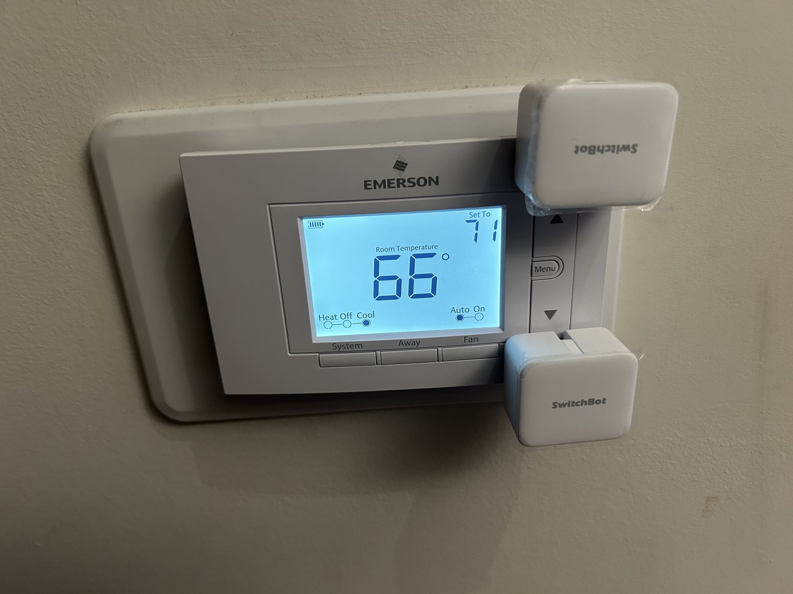
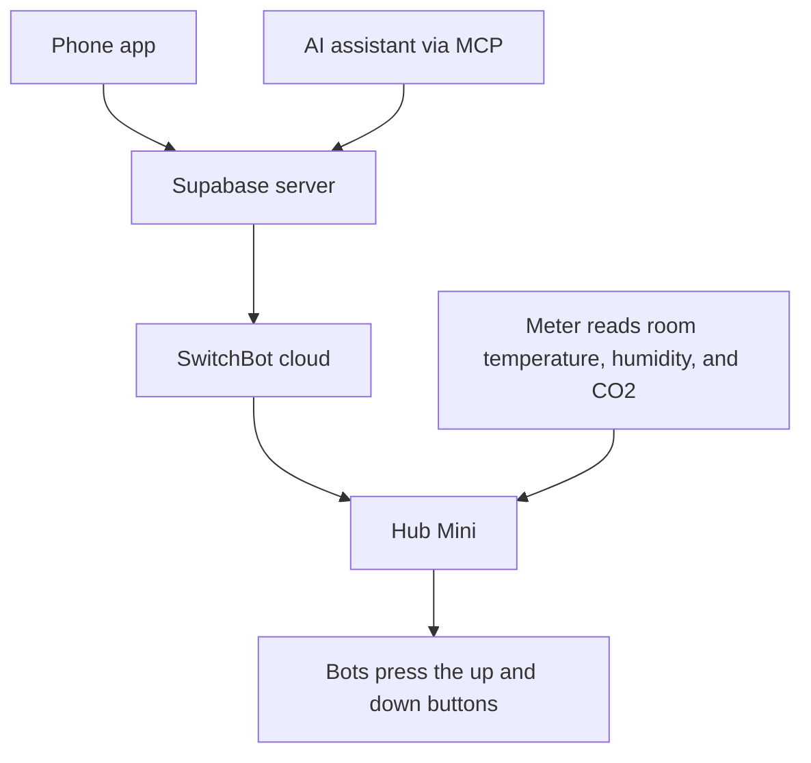
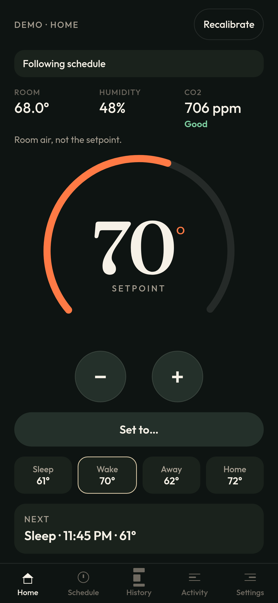
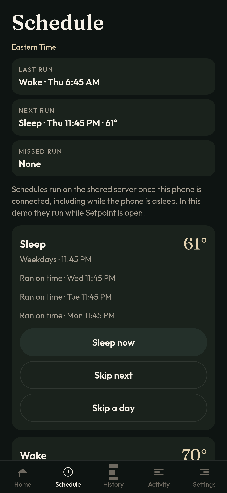
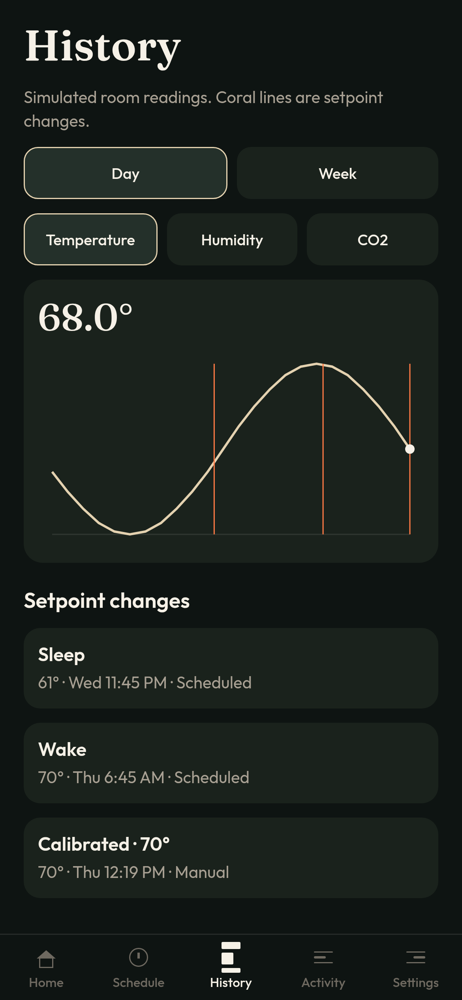
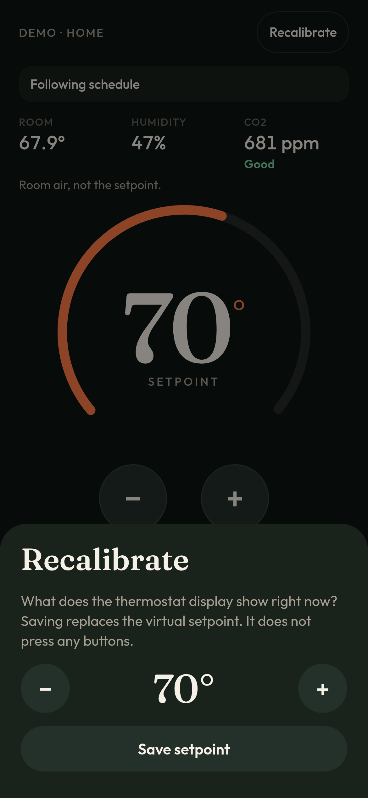
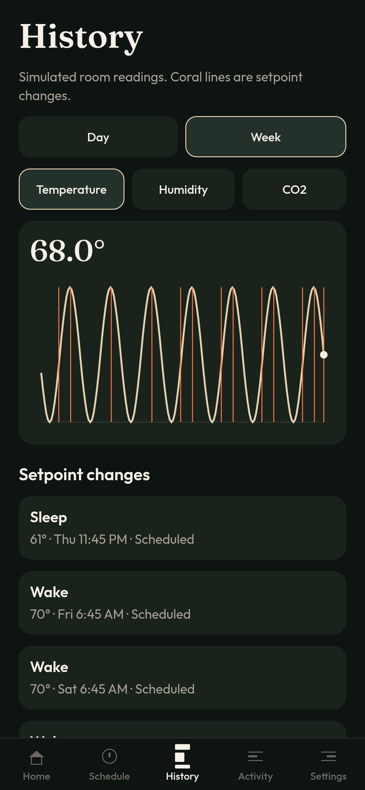
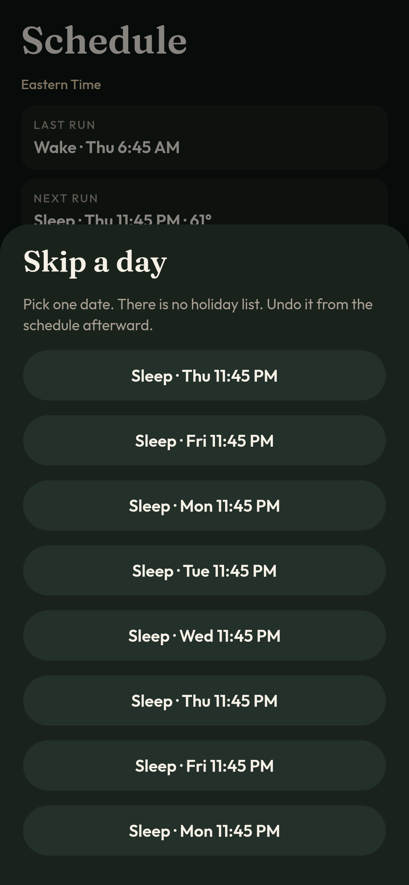
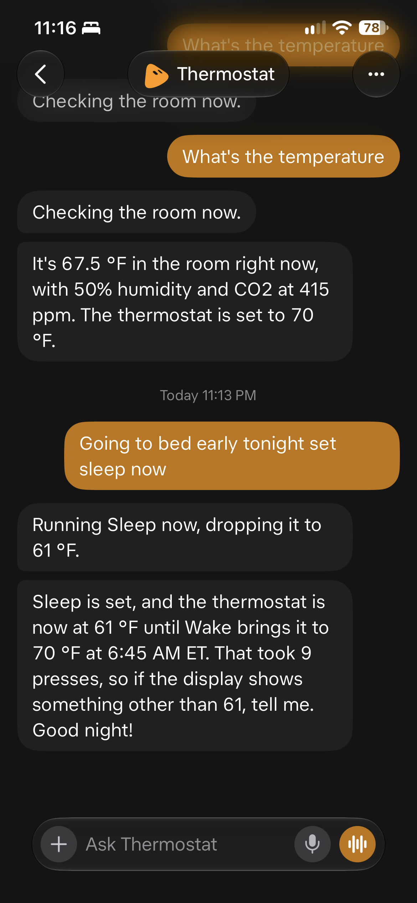

# Setpoint

Setpoint turns a regular, non-smart thermostat into a smart one. Two SwitchBot Bots sit on the up and down buttons and press them for you, and you control it from a phone app.



## Why I made this

I wanted to turn my regular thermostat into a smart one. I wanted to be able to adjust it from my phone and add the ability for custom complex requests even most smart thermostats can't handle.

## What it does

- Set the temperature from your phone. You can turn the dial, use Set to, or tap a preset such as Sleep, Wake, Away, or Home.
- Run a daily schedule. The default is Sleep at 61°F on weekdays at 11:45 PM, and Wake at 70°F every day at 6:45 AM. You can add, edit, or turn off events.
- Skip the next run of a schedule, or skip one date. Both can be undone.
- Sleep now and Wake now apply that target immediately, then mark that run done early or late. They are not a hold, and the next regular run still happens.
- A temporary hold can pause the schedule after you change the temperature by hand in the app. Resume it from Home when you want the schedule to take over again.
- Recalibrate tells the app what the thermostat display actually shows, without pressing any buttons.
- History charts room temperature, humidity, and CO2 for a day or a week, with marks where the setpoint changed.
- An activity log of presses, calibrations, and schedule runs.
- An MCP server so an AI assistant can set the temperature, edit the schedule, skip a wake, recalibrate, and more.
- A Siri shortcut can send a spoken request to a Thermostat bot, which then uses that MCP server.

The Home chip says Following schedule, a hold, or Off schedule. Off schedule means the tracked setpoint does not match the current scheduled target. Tap it to retry. That chip does not use the meter.

## How it works

The thermostat cannot report the number on its display. Setpoint keeps a tracked setpoint, also called the virtual setpoint, by counting successful button presses.



You enter the number on the display once. After that, each successful up press adds one step (default 1°F) and each successful down press subtracts one. If someone presses the physical buttons, or the count drifts, use Recalibrate. Setpoint never waits for the room to reach a target, and it never copies the room sensor into the setpoint. The meter is read-only.

When you set a temperature, the app presses the correct bot the right number of times and waits between presses (default 1 second) so the thermostat can register each one. Requests outside the allowed range (default 50 to 85°F) or over the press cap (default 15) are refused before any press. If a press fails, Setpoint stops, keeps the presses that already succeeded, and does not count the failed one. There is an optional setting, off by default, where the first press only wakes the display and does not change the tracked setpoint.

There are two live paths. On an iPhone, the app can talk to the SwitchBot Open API directly, with the token in the Keychain. When `EXPO_PUBLIC_SUPABASE_URL` and `EXPO_PUBLIC_SUPABASE_PUBLISHABLE_KEY` are set and the app is in live mode, the shared server owns those SwitchBot calls, stores history, and keeps the scheduler running while the phone is asleep. Live control from the browser is not supported. Demo mode never contacts SwitchBot or the server, and there is no Bluetooth fallback.

Schedules use America/New_York (Eastern Time). Catch-up applies only the latest due target and marks earlier ones missed.

## Screenshots

These are from the in-browser demo, at iPhone size. The room readings and charts are simulated. Sleep and Wake are the default schedule.

<table>
  <tr>
    <td align="center"><br>Home</td>
    <td align="center"><br>Schedule</td>
    <td align="center"><br>History, day</td>
  </tr>
  <tr>
    <td align="center"><br>Recalibrate</td>
    <td align="center"><br>History, week</td>
    <td align="center"><br>Skip a day</td>
  </tr>
</table>

## What you need

Hardware, for live control:

- A regular thermostat with physical up and down buttons. This project was built around an Emerson.
- Two SwitchBot Bots, set to Press Mode, mounted on those buttons.
- A SwitchBot Hub Mini, or another SwitchBot hub, near the devices, with cloud service enabled.
- A SwitchBot Meter Pro (CO2), or another SwitchBot meter that reports temperature, humidity, and CO2.

Accounts and software:

- A SwitchBot account, plus an Open API token and secret. In the SwitchBot app: Profile, Preferences, About, tap the app version about 10 times, then Developer Options, token and secret.
- For the shared server, history on the server, schedules while the phone is asleep, and assistant control: a free Supabase project and the [Supabase CLI](https://supabase.com/docs/guides/cli).
- Node.js 22.13 or later. This app uses Expo SDK 58, which supports Node 22.13+, 24.3+, or 26+. Odd-numbered releases such as 23 and 25 are not supported.
- Expo Go, if you want to run the app on a phone during development.

You can try the app in demo mode with only Node.js. No SwitchBot account or Supabase project is required for that.

## Getting started

### Try the demo

Demo mode is the default. It uses simulated devices and works without any environment variables.

```bash
git clone https://github.com/sixtusijoma/setpoint.git
cd setpoint
npm install
npm run web
```

`npm run web` serves the app on port 43117. Open [http://127.0.0.1:43117](http://127.0.0.1:43117), tap Try the demo, and enter a starting temperature. You can turn the dial, run Sleep now, edit the schedule, and browse the charts. The simulated room starts near 68.4°F, 47% humidity, and about 740 ppm CO2. Pull to refresh drifts that room. It does not move the setpoint.

On a phone with Expo Go:

```bash
npm start
```

Then scan the QR code. `npm start` runs `expo start`. `npm run ios` and `npm run android` start the same dev server pointed at those platforms.

### Set up live control

1. Mount the two bots on the thermostat's up and down buttons, in Press Mode. Place the Hub Mini nearby with cloud service enabled, and place the meter in the room.
2. Copy the SwitchBot Open API token and secret from the SwitchBot app, using the path under [What you need](#what-you-need).

**Phone only.** You can skip the server and run live mode from the iPhone app. Start the app, choose Connect SwitchBot, enter the token and secret, map the up bot, down bot, and meter, then enter the number on the thermostat display. The token stays in the Keychain via `expo-secure-store`. This is not a safe path in the browser: a token saved there lasts only for that tab session, and cloud control from the browser is blocked. Without the shared server, the scheduler only runs while the app can run.

**Shared server.** Use this when you want schedules to keep running while the phone is asleep, history stored on the server, and assistant control through MCP. The steps below are the main path. [DEPLOY.md](DEPLOY.md) has the full detail, including cron jobs and how each function is authenticated.

1. Create a free Supabase project, then from this repo, with the Supabase CLI logged in as an owner of that project:

   ```bash
   supabase link --project-ref <your-project-ref>
   supabase db push
   ```

   That applies `supabase/migrations/20261111120000_setpoint.sql`.

2. Set these function secret names in the project. The CLI prompts for the values. Do not put the values in the repo, in `EXPO_PUBLIC_*` variables, or in the app bundle.

   ```bash
   supabase secrets set SWITCHBOT_TOKEN SWITCHBOT_SECRET SETPOINT_APP_KEY SETPOINT_MCP_KEY CRON_SECRET
   ```

   Generate `SETPOINT_APP_KEY` yourself and enter the same value once in the app later. `SWITCHBOT_TOKEN` and `SWITCHBOT_SECRET` can be omitted here if the phone will upload them through Settings. The scheduler still needs one of those two sources before it can press.

3. Deploy the functions:

   ```bash
   supabase functions deploy state
   supabase functions deploy press
   supabase functions deploy recalibrate
   supabase functions deploy session
   supabase functions deploy tick
   supabase functions deploy meter
   supabase functions deploy history
   supabase functions deploy credentials
   supabase functions deploy devices
   supabase functions deploy prune
   supabase functions deploy mcp
   ```

4. Schedule the server jobs as described in [DEPLOY.md](DEPLOY.md). A tick runs every minute, a meter read every 10 minutes, and a prune job once a day.

5. Point the app at the project. You can export these in your shell, or put them in a `.env` file in the project root (that file is gitignored):

   ```bash
   EXPO_PUBLIC_SUPABASE_URL=https://<project-ref>.supabase.co
   EXPO_PUBLIC_SUPABASE_PUBLISHABLE_KEY=<the public anon key>
   ```

   Use the public anon key, not the service role key. The service role key stays on the server. Do not put the SwitchBot token, the MCP key, or the app key in these variables. Demo mode ignores them.

6. Start the app with `npm start` or `npm run ios`. When those two variables are set, the app asks for `SETPOINT_APP_KEY` once and stores it with `expo-secure-store` on iOS and Android. On the web demo, secure storage is unavailable, so the key stays in `sessionStorage` for that tab only. Then enter the SwitchBot token and secret if the server does not already have them, map the devices, and enter the number on the thermostat display.

## Control it with Siri

I use an iOS Shortcut named Thermostat. It runs Dictate Text, then sends that text with the Grok Bot app's Send Message action to my Thermostat bot. The bot controls Setpoint through its MCP server, so a phrase like "Going to bed early tonight set sleep now" can run Sleep now, the same command the app uses. I trigger the shortcut with Siri, or with Back Tap.



## Control it with an AI assistant

After the shared server is deployed, an MCP client can call:

```text
https://<project-ref>.supabase.co/functions/v1/mcp
```

with this header:

```text
Authorization: Bearer <SETPOINT_MCP_KEY>
```

Send JSON-RPC over HTTP `POST` with `Content-Type: application/json`. The function also accepts `Accept: application/json`. If the gateway asks for an `apikey` header, send the public anon key there. The function does not treat that header as the MCP secret. The app key does not open this endpoint.

A client starts with `initialize`, then `notifications/initialized`, then `tools/list` and `tools/call`.

Tools: `set_to`, `nudge`, `read_room`, `room_history`, `show_schedule`, `edit_schedule`, `skip_wake` (pass `undoKey` to undo), `run_schedule_now`, `recalibrate` (corrects the tracked setpoint to what the display shows, presses nothing), and `status`.

See [DEPLOY.md](DEPLOY.md) for the rest of the server notes.

## Project structure

```text
src/app/           Screens: Home, Schedule, History, Activity, Settings, and onboarding
src/components/    Dial, charts, and shared UI
src/domain/        Schedule, presses, and setpoint logic
src/devices/       SwitchBot API client and the demo room simulator
src/server/        Shared server handlers and the MCP tools
src/state/         App state and sync with the shared server
src/storage/       Local persistence and credential storage
supabase/          Database migration, edge functions, and cron SQL
docs/images/       Photos used in this README
```

## Tests

```bash
npm test
npm run typecheck
```

`npm test` runs Vitest. The suite loads the database migration into PGlite and covers the press lease, the scheduler, skips, run-now, meter prune, and the MCP tools. `npm run lint` is also available.
